<picture><source media="(prefers-color-scheme: dark)" srcset="assets/header-ua-dark.svg"><source media="(prefers-color-scheme: light)" srcset="assets/header-ua-light.svg"></picture>

Hey, I'm Sabit. I study Computing Science at the University of Alberta with a focus on artificial intelligence, and I like building things people actually touch: an Android app that makes packed event sign ups fair, APIs that come up cleanly in a container, and this term a learning platform for a food rescue company as part of my capstone. Outside of class I work retail in Edmonton, which teaches you a lot about real users, fast.

 

<picture><source media="(prefers-color-scheme: dark)" srcset="assets/sec1-dark.svg"><source media="(prefers-color-scheme: light)" srcset="assets/sec1-light.svg">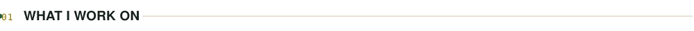</picture>

<picture><source media="(prefers-color-scheme: dark)" srcset="assets/focus-dark.svg"><source media="(prefers-color-scheme: light)" srcset="assets/focus-light.svg"></picture>

 

<picture><source media="(prefers-color-scheme: dark)" srcset="assets/sec2-dark.svg"><source media="(prefers-color-scheme: light)" srcset="assets/sec2-light.svg">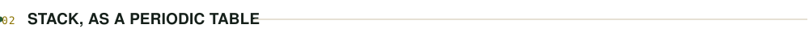</picture>

<picture><source media="(prefers-color-scheme: dark)" srcset="assets/stack-dark.svg"><source media="(prefers-color-scheme: light)" srcset="assets/stack-light.svg"></picture>

 

<picture><source media="(prefers-color-scheme: dark)" srcset="assets/sec3-dark.svg"><source media="(prefers-color-scheme: light)" srcset="assets/sec3-light.svg">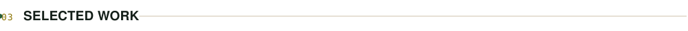</picture>

<a href="https://github.com/tasfikamali-rgb/EventLottery"><picture><source media="(prefers-color-scheme: dark)" srcset="assets/eventlottery-dark.svg"><source media="(prefers-color-scheme: light)" srcset="assets/eventlottery-light.svg"></picture></a>

<picture><source media="(prefers-color-scheme: dark)" srcset="assets/knead-dark.svg"><source media="(prefers-color-scheme: light)" srcset="assets/knead-light.svg">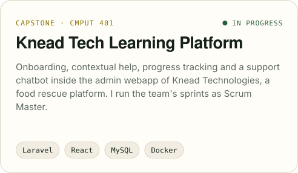</picture>
<picture><source media="(prefers-color-scheme: dark)" srcset="assets/databases-dark.svg"><source media="(prefers-color-scheme: light)" srcset="assets/databases-light.svg">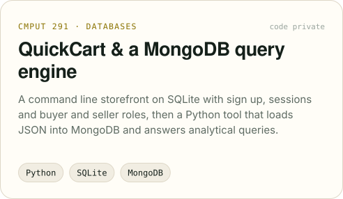</picture>

Most of my code lives in private course and client repos because of academic integrity rules and client confidentiality. Happy to walk through any of it on a call.

  

<picture><source media="(prefers-color-scheme: dark)" srcset="assets/sec4-dark.svg"><source media="(prefers-color-scheme: light)" srcset="assets/sec4-light.svg">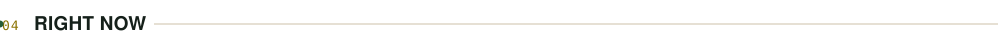</picture>

<picture><source media="(prefers-color-scheme: dark)" srcset="assets/now-dark.svg"><source media="(prefers-color-scheme: light)" srcset="assets/now-light.svg">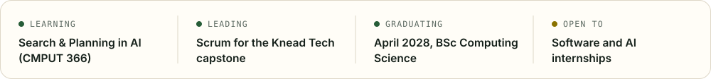</picture>

 

<picture><source media="(prefers-color-scheme: dark)" srcset="assets/sec5-dark.svg"><source media="(prefers-color-scheme: light)" srcset="assets/sec5-light.svg">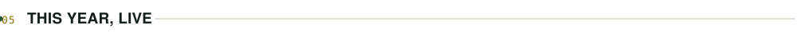</picture>

<picture><source media="(prefers-color-scheme: dark)" srcset="assets/contrib-dark.svg"><source media="(prefers-color-scheme: light)" srcset="assets/contrib-light.svg"></picture>

 

<a href="mailto:tasfi@ualberta.ca"><picture><source media="(prefers-color-scheme: dark)" srcset="assets/footer-dark.svg"><source media="(prefers-color-scheme: light)" srcset="assets/footer-light.svg">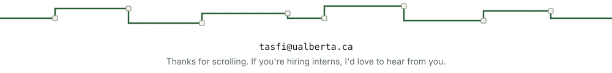</picture></a>

